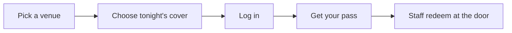

# LinePass

**Skip the cover line. Buy your bar pass on your phone, show it at the door, and you're in.**

LinePass is a mobile-first web app for buying and redeeming nightly cover passes at Champaign bars, starting with **KAMS** and **Red Lion**. It installs to your phone's home screen and works like a native app: full screen, fast, and with no page reloads.

**Live:** [line-pass.vercel.app](https://line-pass.vercel.app)

---

## Features

- **Browse venues.** See participating bars and their hours at a glance.
- **Tonight's covers.** Each venue shows the cover options for that night, including special nights.
- **Digital pass.** Your pass lives on your phone and is good for the whole night.
- **Door redemption.** Staff redeem the pass at the door with a single tap and a confirmation animation.
- **Secure accounts.** Each account is protected and limited to one device, so passes can't be shared.
- **Admin tools.** A private dashboard for managing users and tracking passes.

## How it works



## Built with

- [Next.js](https://nextjs.org) + React + TypeScript
- [Tailwind CSS](https://tailwindcss.com)
- [Supabase](https://supabase.com) (Postgres)
- [Vercel](https://vercel.com) for hosting

## Getting started

```bash
npm install
cp .env.example .env.local   # then fill in your own values
npm run dev
```

Open [localhost:3000](http://localhost:3000). Database setup files are in the `supabase/` folder.

On an iPhone, open the site in Safari and tap **Share → Add to Home Screen** for the full-screen app.

## Status

LinePass is in active development. More venues and features are on the way.
